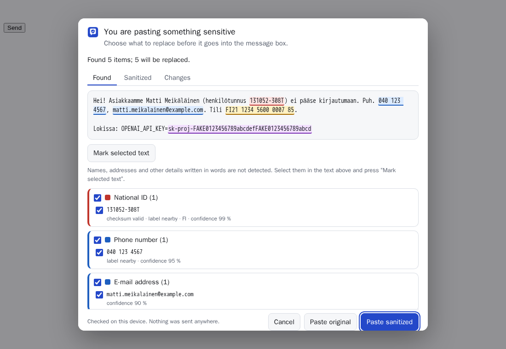
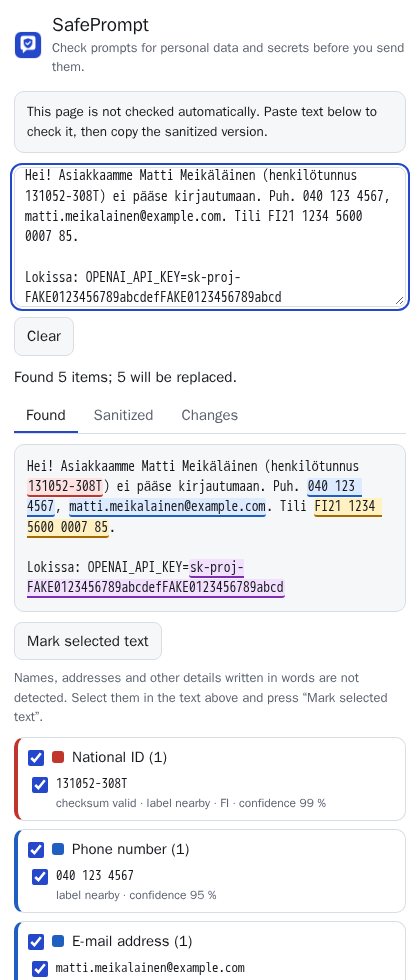
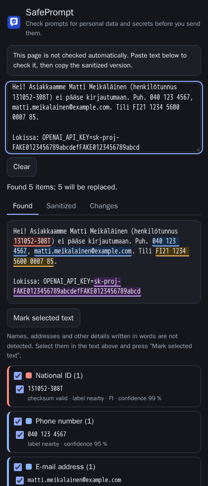

# SafePrompt

**Check your AI prompt for personal data and secrets before you send it — on your own device.**

[](https://github.com/sinceaihq/safeprompt/actions/workflows/ci.yml)
[](https://huggingface.co/spaces/sinceaihq/safeprompt-demo)
[](https://huggingface.co/datasets/sinceaihq/safeprompt-bench)
[](LICENSE)

People paste customer e-mails, spreadsheets, logs and config files into ChatGPT, Gemini and Claude every day —
and with them national ID numbers, bank accounts, phone numbers and API keys. SafePrompt is a free browser
extension that notices those values, shows you exactly what it found, and gives you a sanitized version to send
instead.

<p align="center">
  
</p>

- **European identifiers, validated.** National ID numbers of 22 countries, EU VAT numbers and IBANs are checked
  with their official check-digit and date rules, so order numbers, invoice numbers and barcodes are not flagged.
  It also finds payment cards, e-mail addresses, phone numbers, IP addresses, passwords and API keys.
- **Made for what people actually paste.** Understands spreadsheet columns, JSON keys, SQL inserts, `.env` files,
  logs and `curl` commands, not only prose.
- **Stays on your device.** Detection runs in your browser. SafePrompt has no server, no account and no
  analytics, and makes no network requests.
- **You decide.** Every value can be kept or replaced. SafePrompt never sends a message for you.
- **Placeholders you can undo.** Values become `<EMAIL_1>`, `<IBAN_1>`, … so the AI can still follow your text;
  paste its answer back into SafePrompt to restore the originals locally.

> **SafePrompt helps you notice; it is not a guarantee.** It does not detect names or addresses written in words,
> can miss values without a label, and using it does not make data anonymous or any processing GDPR-compliant.
> Always read what you send. (Why no name detection yet: [our NER study](eval/ner/README.md).)

## Install

SafePrompt works in Chrome, Edge, Brave and other Chromium browsers (version 116 or newer). It is not in the
Chrome Web Store yet; install the tested release package:

1. Download `safeprompt-0.1.0.zip` from the [latest release](https://github.com/sinceaihq/safeprompt/releases/latest)
   and unzip it.
2. Open `chrome://extensions`, switch on **Developer mode** (top right).
3. Click **Load unpacked** and choose the unzipped folder.
4. Pin SafePrompt to the toolbar and click it to open the side panel.

Want to try it first? The [web demo](https://huggingface.co/spaces/sinceaihq/safeprompt-demo) runs the same
engine in a normal web page.

## How to use it

**On ChatGPT and Gemini** SafePrompt checks text automatically:

- when you **paste** into the message box, a review opens if anything sensitive is in the clipboard text — choose
  _Paste sanitized_, _Paste original_ or _Cancel_;
- when you press **Enter or the send button**, the message is checked; if it contains something sensitive, it is
  not sent and the review opens. _Replace in message_ swaps in the sanitized text — you then press send yourself.

**Anywhere else**, open the side panel, paste your text, untick anything that is fine to share, and press
**Copy sanitized**. On other AI chat sites you can choose _Protect this site_ in the side panel (it asks for access
to that one site).

In the review, the _Changes_ tab shows exactly what will be replaced. Names and other details written in words are
not detected: select them in the text and press _Mark selected text_. Settings let you pick the countries you deal
with (their identifiers are then found even without a label), a sensitivity level, your own words to always flag
(client or project names) and values never to flag.

<p align="center">
  
  
</p>

## What it finds

|                             |                                                                                                                                                                                                                                                                                                               |
| --------------------------- | ------------------------------------------------------------------------------------------------------------------------------------------------------------------------------------------------------------------------------------------------------------------------------------------------------------- |
| national IDs (22 countries) | AT SVNR · BE national number · BG EGN · CZ/SK rodné číslo · DE Steuer-ID · DK CPR · EE isikukood · ES DNI/NIE · FI henkilötunnus · FR NIR · HR OIB · IE PPSN · IT codice fiscale · LT asmens kodas · LV personas kods · NL BSN · NO fødselsnummer · PL PESEL · PT CC/NIF · RO CNP · SE personnummer · SI EMŠO |
| financial                   | IBAN (all countries) · EU VAT numbers (all member states) · payment cards (issuer, length, Luhn)                                                                                                                                                                                                              |
| contact                     | e-mail (also `name(at)domain`) · phone numbers in EU/EEA formats, also `00`-prefixed · IPv4/IPv6                                                                                                                                                                                                              |
| secrets                     | AWS, GitHub, GitLab, Slack, Stripe, Google, OpenAI, Anthropic, Hugging Face, npm, PyPI and SendGrid keys · JSON Web Tokens · private key blocks · passwords in URLs · values after `password:`, `api_key=`, `token:` … · `Bearer` credentials                                                                 |
| not detected                | names, postal addresses, dates of birth, free-text descriptions, images and files                                                                                                                                                                                                                             |

A value counts as a national ID only if its check digits and encoded birth date are valid. Plain digit strings that
pass a checksum by chance are reported only next to a label ("PESEL", "Steuer-ID", a `bsn` column …) or when you
told SafePrompt to expect that country.

## How well does it work?

Measured on [SafePrompt-Bench](https://huggingface.co/datasets/sinceaihq/safeprompt-bench), 1,500 synthetic
documents of the kinds people paste into AI chats — `.env` files, logs, JSON, CSV, `curl` commands, code, SQL,
stack traces, e-mails in nine languages, chat messages — with 5,600 annotated values and 299 documents that contain
nothing sensitive but plenty of look-alikes (UUIDs, hashes, order numbers, barcodes, invalid IDs). Personal data
only (secrets excluded so the systems are comparable):

| system                             | precision | recall   | F1       | clean documents wrongly flagged |
| ---------------------------------- | --------- | -------- | -------- | ------------------------------- |
| **SafePrompt 0.1.0**               | **99.7**  | **97.0** | **98.3** | **1 of 299**                    |
| EuroPII Guard 0.1.2                | 93.7      | 83.9     | 88.6     | 79 of 299                       |
| Microsoft Presidio + EuroPII Guard | 81.7      | 91.2     | 86.2     | 194 of 299                      |
| Microsoft Presidio (default)       | 80.8      | 70.5     | 75.3     | 177 of 299                      |

Most misses are identifiers written in running text without any label ("their number is …"); with the country set
in the settings, those are found too. On the independent [EuroPII benchmark](https://huggingface.co/datasets/sinceaihq/europii-bench)
(2,075 messages) SafePrompt scores 97.2 precision and 96.8 recall. Detection takes under a millisecond per message.

**Read these numbers with care.** The benchmark is synthetic and was written by the same team as SafePrompt; the
test split was generated with a fresh seed and evaluated once, but it shares templates with the development split
used for tuning, while the other systems were not tuned on it at all. Secrets are left out of the table because the
benchmark uses the same documented key formats that SafePrompt looks for (SafePrompt finds all of them by construction). Real text is messier. Details, per-format
results and errors: [docs/BENCHMARK.md](docs/BENCHMARK.md).

## Privacy

- Text is analysed in the extension, in your browser. The extension contains no code that sends data over the
  network, and its pages are locked down by a content security policy that only allows the extension's own scripts.
- The review dialog on a chat site is an extension page in an isolated frame: the site's scripts cannot read what it
  shows. SafePrompt's listeners run before the page's own, so a blocked paste never reaches the page.
- Nothing you check is stored. A paste waiting for your decision is held in the browser's in-memory session storage
  and deleted when you decide. Your settings are stored locally (not synced).
- Permissions: `sidePanel`, `storage`, `scripting`, `activeTab`, and access to chatgpt.com, gemini.google.com and
  claude.ai. Access to any other site is requested only when you choose _Protect this site_.

See [docs/PRIVACY.md](docs/PRIVACY.md) and the [security review](docs/SECURITY_REVIEW.md).

## Supported sites

| site                | paste check | send check  | how it was tested                                                                       |
| ------------------- | ----------- | ----------- | --------------------------------------------------------------------------------------- |
| ChatGPT             | ✓           | ✓           | replica of the current page; the live site shows a bot check to automated test browsers |
| Gemini              | ✓           | ✓           | live site (signed out) and replica                                                      |
| Claude              | opt-in      | opt-in      | replica only (the live site needs a sign-in); off by default                            |
| other sites you add | ✓           | best effort | generic rules                                                                           |

Sites change their pages often. SafePrompt shows in the toolbar and side panel whether it found the message box on
the current page (green ✓) or not (!), and only claims protection when it did. Voice input, file uploads and text
typed into other fields are not checked. See [docs/TESTING.md](docs/TESTING.md).

## How it works

```
 paste / Enter / send ─► content script (runs first, in an isolated world)
                              │ text
                              ▼
                    detection engine (TypeScript)
     candidate patterns ─► checksum + date validation ─► label resolution ─► score
     (regex, libphonenumber)   (22 national ID schemes,   (nearest label, column
                                VAT, IBAN, Luhn)           headers, JSON keys)
                              │ findings
                              ▼
     review dialog (extension iframe) ─► you choose ─► sanitized text into the message box
```

The engine is a port of [EuroPII Guard](https://github.com/sinceaihq/europii-guard) to TypeScript. Its check-digit
validators are tested against python-stdnum on 43,469 generated cases with no disagreement; on top of that,
SafePrompt adds secret detection, table- and field-aware label handling and protections against look-alikes. See
[docs/ENGINE.md](docs/ENGINE.md).

## Development

```bash
npm ci
npm run build          # dist/extension (load unpacked) and dist/web (demo)
npm test               # unit tests, validator parity, benchmark regression
npx playwright install chromium
npm run test:e2e       # the real extension on replica chat pages
npm run lint && npm run typecheck
node scripts/build.mjs --zip   # reproducible dist/safeprompt-<version>.zip + SHA256SUMS
```

The build is deterministic: rebuilding a release tag gives a zip with the same SHA-256 as the published one.
Benchmark: `python eval/bench/generate.py …` and `npx tsx eval/bench/evaluate.ts --data eval/bench/data/test.jsonl`
(see [docs/BENCHMARK.md](docs/BENCHMARK.md)).

## Related Since AI projects

- [EuroPII Guard](https://github.com/sinceaihq/europii-guard) — the Python library SafePrompt's engine comes from.
- [EuroDocBench](https://github.com/sinceaihq/eurodocbench) — benchmark for European invoice extraction.
- [EuroTender](https://github.com/sinceaihq/eurotender) — CPV classification of EU tender notices.

## Licence

Apache-2.0. SafePrompt bundles [libphonenumber-js](https://github.com/catamphetamine/libphonenumber-js) (MIT), which
contains Google's libphonenumber metadata (Apache-2.0). See [NOTICE](NOTICE).

---

Made by [Since AI](https://sinceai.ai), a non-profit association in Finland. Issues and pull requests are welcome —
especially false alarms and missed values from real use (with the values replaced, please).
